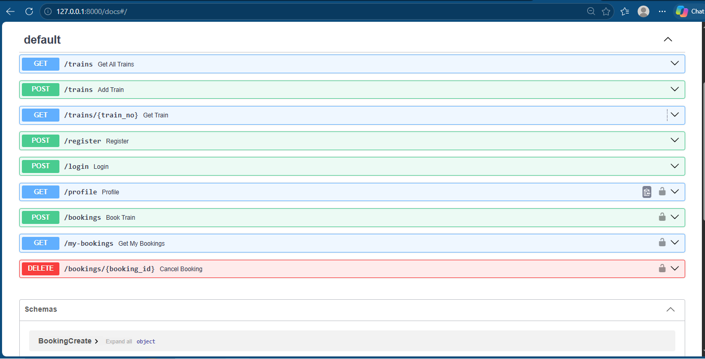
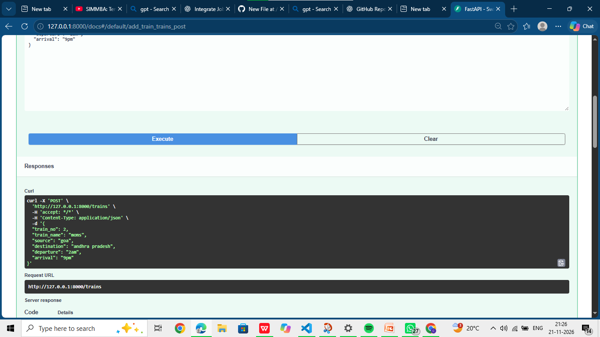
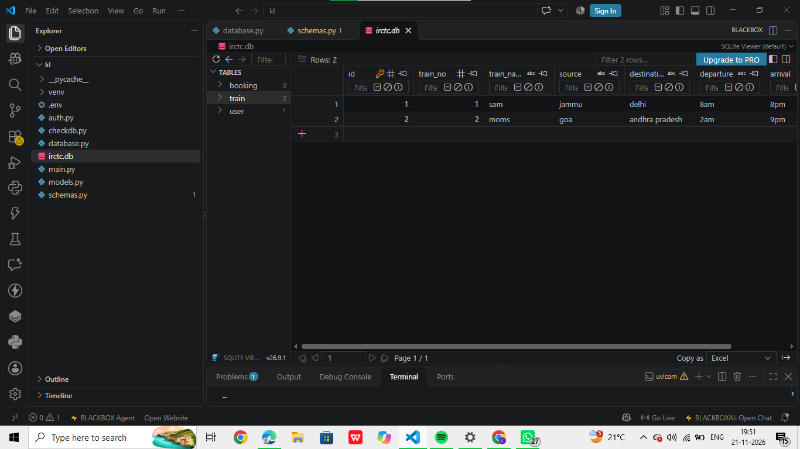

# IRCTC – Train Reservation System Backend

## About the Project

IRCTC is a backend-based Train Reservation System developed using FastAPI as part of a course assignment.

The project provides REST APIs for train management, user registration and login, profile access, and train ticket booking. It uses SQLite for data storage and SQLModel for database operations.

## Technology Stack

- **Programming Language:** Python
- **Backend Framework:** FastAPI
- **Database:** SQLite
- **ORM:** SQLModel
- **Data Validation:** Pydantic
- **API Server:** Uvicorn
- **API Documentation:** Swagger UI

## Features

- Add and retrieve train details.
- Search trains using train numbers.
- User registration and login.
- Authenticated user profile access.
- Book train tickets.
- View personal booking history.
- Cancel train bookings.
- Database management using SQLite and SQLModel.

## API Endpoints

### 1. Train Management

| Method | Endpoint | Description |
|---|---|---|
| GET | `/trains` | Get all trains |
| POST | `/trains` | Add a new train |
| GET | `/trains/{train_no}` | Get train details |

### 2. User Authentication

| Method | Endpoint | Description |
|---|---|---|
| POST | `/register` | Register a new user |
| POST | `/login` | Login user |
| GET | `/profile` | Get authenticated user profile |

### 3. Ticket Booking

| Method | Endpoint | Description |
|---|---|---|
| POST | `/bookings` | Book a train ticket |
| GET | `/my-bookings` | Get user's bookings |
| DELETE | `/bookings/{booking_id}` | Cancel a booking |

## Project Structure

```text
IRCTC/
│
├── auth.py
├── checkdb.py
├── database.py
├── irctc.db
├── main.py
├── models.py
├── schemas.py
├── requirements.txt
├── .gitignore
├── README.md
│
└── screenshots/
    ├── api-documentation.png
    ├── train-creation.png
    └── database.png
```

## Screenshots

### 1. API Documentation – Swagger UI

Displays all available API endpoints for train management, authentication, and ticket booking.



### 2. Train Creation – Successful API Response

Demonstrates successfully adding a new train using the POST `/trains` endpoint and receiving the train details in JSON format.



### 3. SQLite Database

Shows the SQLite database containing the train, user, and booking tables along with sample train records.



## Installation and Setup

### 1. Clone the Repository

```bash
git clone https://github.com/swayamsachdeva2005-cloud/IRCTC.git
```

### 2. Navigate to Project Directory

```bash
cd IRCTC
```

### 3. Create a Virtual Environment

```bash
python -m venv venv
```

### 4. Activate Virtual Environment

For Windows:

```bash
venv\Scripts\activate
```

### 5. Install Dependencies

```bash
pip install -r requirements.txt
```

### 6. Run the FastAPI Server

```bash
uvicorn main:app --reload
```

The application will run at:

`http://127.0.0.1:8000`

## API Documentation

After starting the server, open Swagger UI:

`http://127.0.0.1:8000/docs`

You can explore and test all available API endpoints using the interactive documentation.

## Database

The project uses SQLite to store train, user, and booking information. SQLModel is used to define database models and perform database operations.

## Author

**Swayam Sachdeva**

## Project Type

Backend Development – Course Assignment
